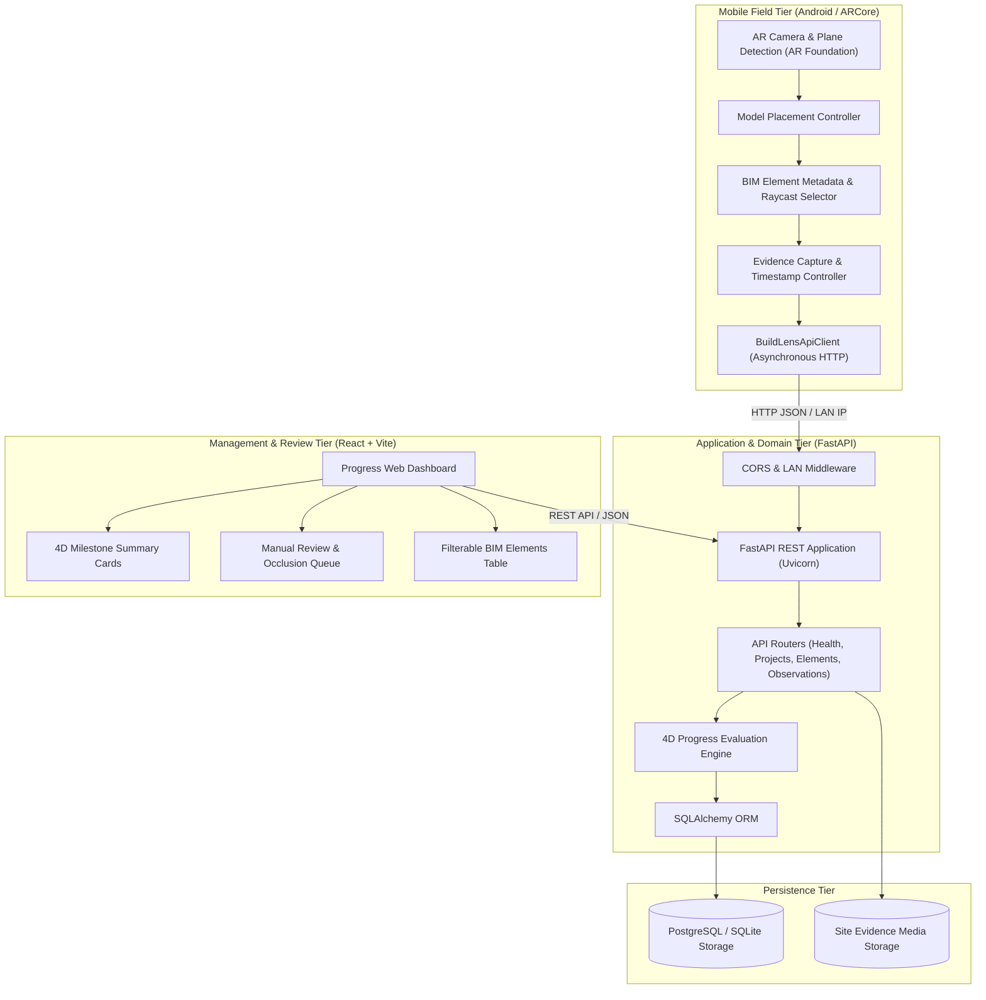

# BuildLens 4D — Architecture & System Design

## 1. Architectural Philosophy & Separation of Concerns

BuildLens 4D is engineered around a foundational rule of construction informatics:

> **Engineering Rule (SRS 8.1):** AR alignment or computer vision detection alone must never be treated as definitive proof that a structural construction element is complete. If an element is hidden, occluded, outside the camera frustum, or uncertain, the system marks it as `needs_manual_review` rather than declaring it missing or incomplete.

To uphold auditability, BuildLens 4D maintains an explicit separation between:
1. **Observation / Field Evidence State:** What the site engineer or vision sensor observed at a specific timestamp (`accepted_complete`, `in_progress`, `not_started`, `occluded`, `uncertain`).
2. **Schedule Interpretation State:** How that accepted observation compares with the planned start and end milestones in the 4D BIM schedule (`verified_complete`, `in_progress`, `potentially_delayed`, `ahead_of_schedule`, `needs_manual_review`, `not_started`).

---

## 2. System Topology

---

## 3. Component Responsibilities

### 3.1 Mobile AR Client (Unity + AR Foundation + Google ARCore)
- Runs on physical Android devices.
- Uses `ARPlaneManager` and `ARRaycastManager` to detect real horizontal ground planes on the construction deck.
- Renders lightweight, bounding-box or low-poly 3D BIM representations aligned with real-world surfaces.
- Attaches `BIMElementMetadata` components to interactable model colliders, exposing stable element IDs (e.g. `COL-B1-01`).
- Captures field photos and camera pose metadata when an observation is logged.
- Communicates with the FastAPI backend over Wi-Fi/LAN.

### 3.2 Backend Service (FastAPI + SQLAlchemy)
- Exposes structured REST endpoints under `/api`.
- Validates all requests using strict Pydantic v2 schemas.
- Implements the 4D progress schedule evaluation engine (`app/services/progress_service.py`).
- Supports dual database backends:
  - **SQLite:** Default zero-friction mode for local development on modest hardware.
  - **PostgreSQL:** Production-grade relational database for multi-user deployment.
- Manages CORS headers allowing local Vite dev servers and mobile Android devices.

### 3.3 Progress Evaluation Engine (`progress_service.py`)
- Evaluates field observations against planned start and completion dates:
  - `accepted_complete` before or on `planned_end` $\rightarrow$ `verified_complete`.
  - `accepted_complete` before `planned_start` $\rightarrow$ `ahead_of_schedule`.
  - `in_progress` past `planned_end` $\rightarrow$ `potentially_delayed`.
  - `occluded` or confidence $< 0.60$ $\rightarrow$ `needs_manual_review`.
  - No observations past `planned_end` $\rightarrow$ `potentially_delayed`.

### 3.4 Web Dashboard (React + Vite)
- Provides construction managers and BIM coordinators with real-time site visibility.
- Displays summary progress metrics: completion percentage, elements complete, in progress, delayed, and requiring review.
- Highlights items in the review queue to ensure engineer oversight on occluded elements.

---

## 4. Mobile Network Architecture & The Android Localhost Trap

When developing mobile AR applications on Android:
- An Android device cannot reach `http://localhost:8000` to communicate with the host laptop. To the mobile OS, `localhost` refers to the mobile device itself (`127.0.0.1`).
- The mobile app must be configured with the host PC's Wi-Fi / Local Area Network (LAN) IP (e.g., `http://192.168.1.100:8000`).
- The backend listens on `0.0.0.0` (all interfaces) rather than binding solely to `127.0.0.1`.

---

## 5. Performance Optimization for Modest Hardware

Given target developer hardware constraints (16 GB RAM, Intel Iris GPU + 2 GB VRAM):
1. **Lightweight Meshes:** BIM models are pre-processed into lightweight meshes with minimal polygon counts, bypassing raw multi-gigabyte IFC file parsing inside Unity.
2. **Asynchronous I/O:** API networking utilizes non-blocking `UnityWebRequest` calls in Unity and async endpoints in FastAPI to eliminate UI freeze.
3. **Local SQLite Dev Database:** Eliminates the memory footprint of background PostgreSQL daemons during early local development.
